<div align="center">

# 🏴‍☠️ Pirate Can Focus Too

**`~ un pirate aussi peut se concentrer ~`**

Une appli Android de concentration où un capitaine pirate en pixel art
surveille ton pont, te raconte des bêtises et jette Instagram par-dessus bord.

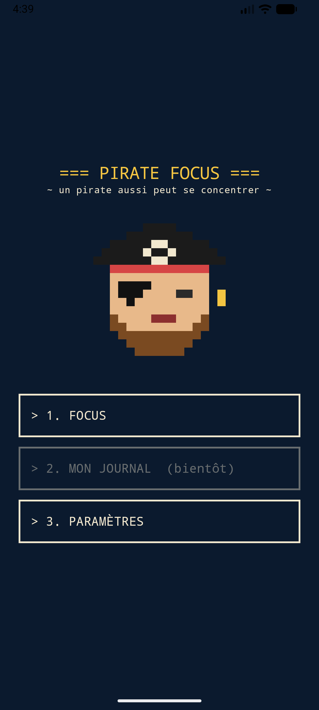

</div>

---

## ⚓ C'est quoi, cette histoire ?

Tu connais la technique Pomodoro : on se concentre un moment, on fait une pause, on recommence.
Ici, c'est pareil, mais **en mer** :

| Dans la vraie vie | Dans Pirate Focus |
| --- | --- |
| Une session de concentration | Une **traversée** ⛵ |
| La pause | Une **escale** au port 🍹 |
| Les points gagnés | Des **doublons** 🪙 (1 par minute, bonus pour les longues traversées) |
| Abandonner | Le **navire coule** 🫧 (et le capitaine pleure) |
| Ouvrir TikTok en plein focus | **À L'ABORDAGE !!!** ☠️ |

Tout est en **pixel art** et en **police monospace**, comme un vieux terminal de bord.

## 🗺️ La visite guidée

<table>
  <tr>
    <td align="center">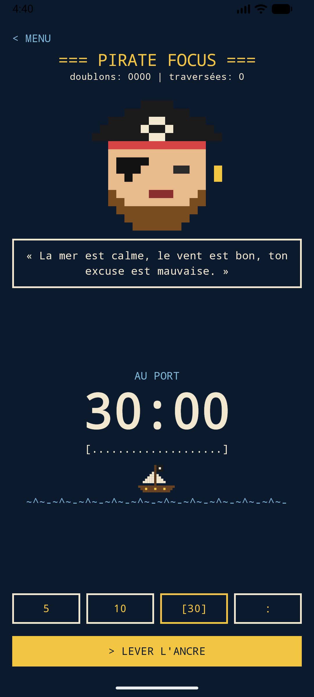<br/><b>Au port</b><br/>Choisis ta traversée : 5, 10, 30 min, ou <code>:</code> pour une durée sur mesure avec une roue qui défile.</td>
    <td align="center">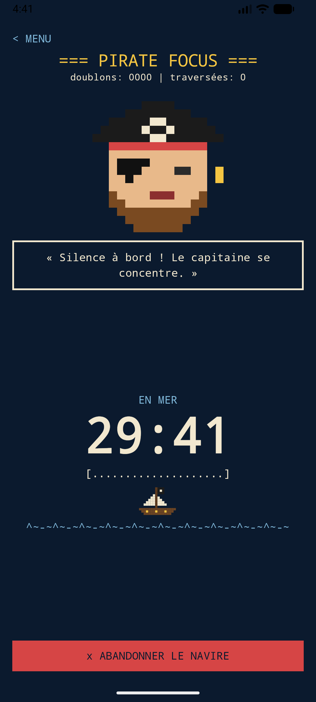<br/><b>En mer</b><br/>Le navire tangue, les vagues défilent, le capitaine exige le silence.</td>
    <td align="center">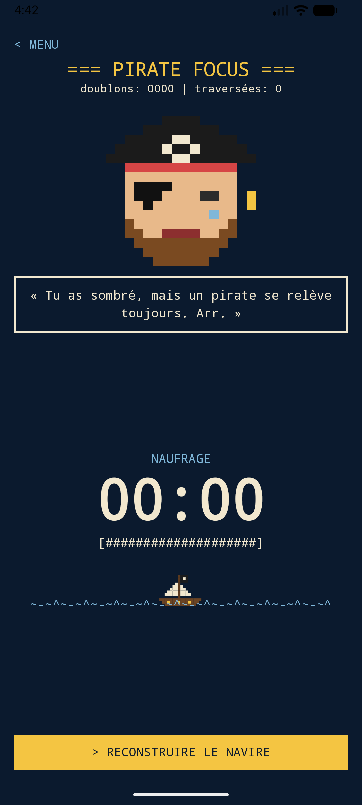<br/><b>Naufrage</b><br/>Tu as abandonné. Le navire coule. Le perroquet est déçu.</td>
  </tr>
  <tr>
    <td align="center">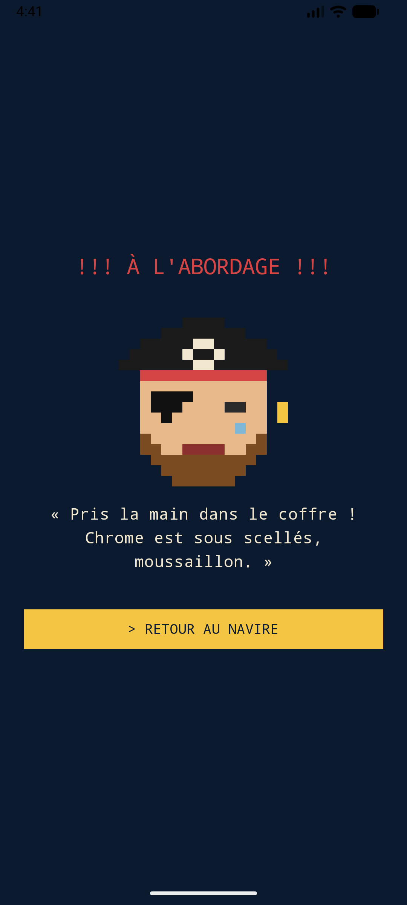<br/><b>À l'abordage !</b><br/>Tu ouvres une appli interdite pendant une traversée ? Le capitaine surgit.</td>
    <td align="center">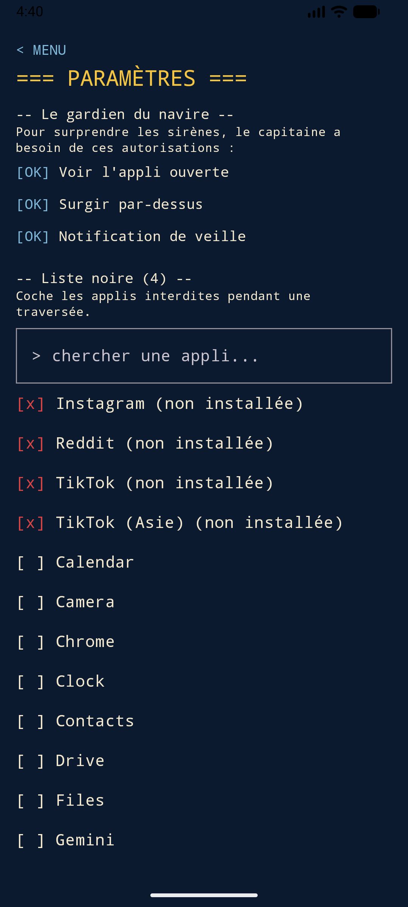<br/><b>Paramètres</b><br/>Ta liste noire d'applis, avec recherche. Instagram, TikTok et Reddit y sont d'office.</td>
    <td align="center">🦜<br/><br/><b>Et aussi...</b><br/>Plus de 150 répliques de pirate tapées à la machine à écrire.<br/><i>« Un pirate qui procrastine, c'est juste un marin en pyjama. »</i></td>
  </tr>
</table>

## 📖 Le journal du capitaine

Dans le menu, « Mon journal » ouvre le grand duel **BISCOTOS 💪 contre TAVERNE 🍺**, arbitré par un capitaine qui n'a pas sa langue dans sa poche.

<table>
  <tr>
    <td align="center">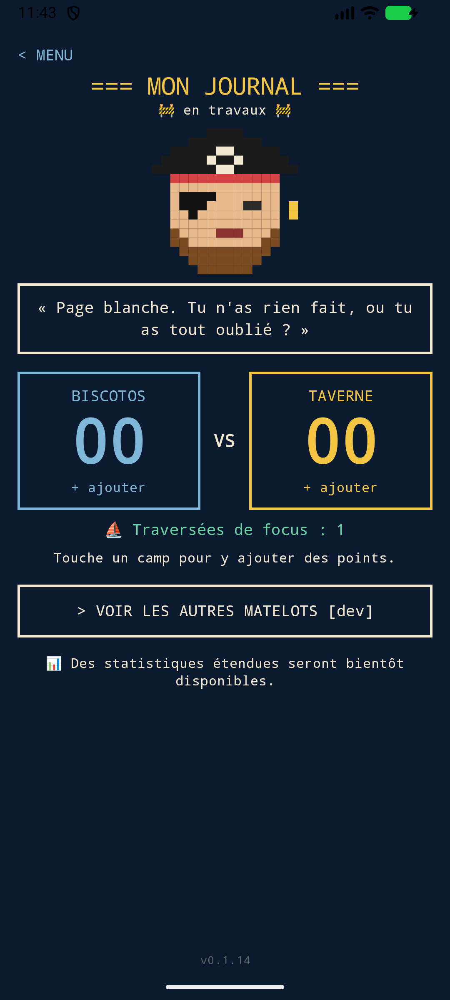<br/><b>Le duel</b><br/>Touche un camp pour y noter une séance ou une tournée. Tes traversées de focus s'y inscrivent toutes seules ⛵.</td>
    <td align="center">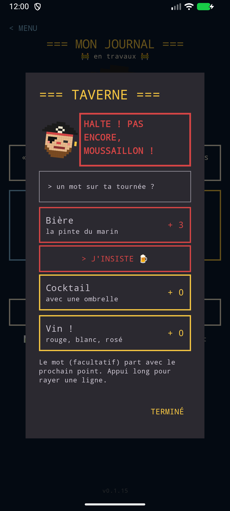<br/><b>« NON ! PAS ENCORE ! »</b><br/>Après 3 verres, le capitaine fait barrage. Il faut appuyer sur « J'INSISTE 🍺 » pour passer.</td>
    <td align="center">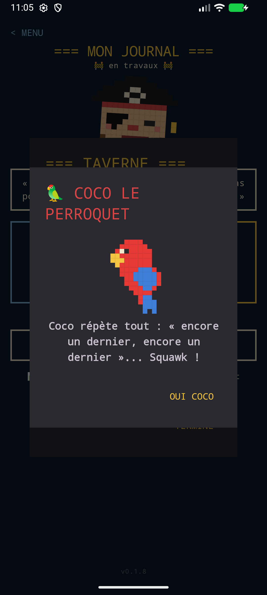<br/><b>Coco le perroquet</b><br/>Au 8e verre de la soirée, Coco débarque : <i>« Mon coco, tu vas devenir fou ! »</i></td>
  </tr>
  <tr>
    <td align="center">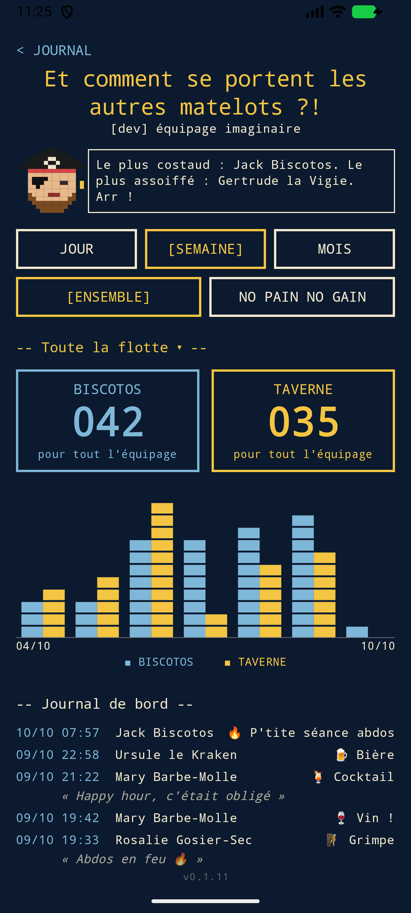<br/><b>ENSEMBLE</b><br/>Les compteurs de tout l'équipage, un graphique pixel art dont les blocs montent, et le journal de bord avec les petits mots de chacun.</td>
    <td align="center">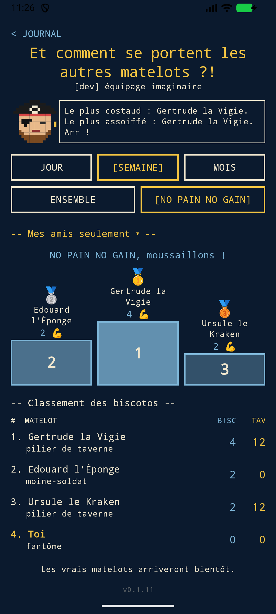<br/><b>NO PAIN NO GAIN</b><br/>Le podium des plus gros biscotos 🥇🥈🥉, en entier ou entre amis seulement.</td>
    <td align="center">🏴‍☠️<br/><br/><b>Le capitaine juge</b><br/>Pilier de taverne, éponge de cale, moine-soldat... Selon ton score, il te félicite ou t'insulte. Et quand la taverne mène, il devient pompette.</td>
  </tr>
</table>

Le journal et le coffre de doublons sont **gardés sur le téléphone** d'un lancement à l'autre.
« Voir les autres matelots » montre les **vrais pirates publics** de la flotte (ceux qui ont un compte et l'ont choisi).

## 🔐 Ton compte (facultatif)

Aucun compte n'est obligatoire : au premier lancement, le capitaine te laisse choisir.

| Matelot anonyme | Compte gratuit |
| --- | --- |
| Un pseudo de pirate (tiré au dé 🎲, ou le tien) et c'est tout. | Un **email** (simple identifiant privé : jamais vérifié, aucun mail envoyé) + un **mot de passe** + un **code secret**, montré une seule fois, qui remet un mot de passe oublié. |
| Journal et coffre restent **dans la cale du téléphone**. Un tag discret `[ Compte local ]` sous le titre le rappelle (et se trémousse toutes les 10 s). | Journal et coffre **synchronisés** en ligne : ils te suivent sur un autre téléphone. |
| | Ou en un geste : **CONTINUER AVEC GOOGLE**. |

- 🪜 **Création en étapes**, une chose à la fois : email + mot de passe (jauge de solidité, œil pixel art pour afficher) → pseudo → code secret.
  Connexion : email → mot de passe (« mot de passe oublié ? » part de là).
- 🔗 **Passer en ligne sans rien perdre** : à la connexion, le journal du téléphone rejoint le compte, et le coffre garde le plus gros butin.
- 🧷 **Lier Google à son compte** (dans la fiche) : un seul pirate, deux passerelles, pas de second compte par erreur.
- 🪪 **Ma fiche de matelot** : identité (pseudo, email privé), sécurité (nouveau code secret, mot de passe, Google lié), visibilité publique,
  et une **zone dangereuse** bien à l'écart (se déconnecter, supprimer son compte).
- ☠️ **Supprimer son compte** : email et connexion jetés par-dessus bord, tes exploits restent au classement sous le nom d'un « Ancien matelot ».
- 🍞 Des **toasts** du capitaine à chaque connexion ou déconnexion : *« Bienvenue à bord, &lt;pseudo&gt; ! Yawkü ! »*
- 🛡️ **Anti-devinettes** côté serveur : après 5 mots de passe ratés, la cale est verrouillée 2 minutes (+1 par nouvel échec), et c'est annoncé.

## 🦜 Fonctionnalités

- ⏱️ **Minuteur façon Pomodoro** avec durées prédéfinies ou sur mesure (1 à 180 min)
- 🪙 **Doublons et traversées** comptés à chaque session terminée, et gardés dans le coffre
- ☠️ **Gardien du navire** : bloque les applis de ta liste noire pendant le focus
- 🙋 **Le capitaine réclame ses autorisations** gentiment (« SUIVRE LE CAPITAINE ») quand le gardien ne peut pas veiller :
  la 1re fois, puis 1 traversée sur 3. Dans les applis bloquées, une autorisation manquante clignote en rouge,
  et toucher une autorisation accordée ouvre son réglage pour la retirer
- 👋 **Un accueil qui salue** : au premier lancement, le capitaine lève les yeux, sourit, sautille et se dandine
- 🔍 **Recherche d'applis** dans la liste noire (sans se soucier des accents), et « tout débloquer » en un geste
- ⌨️ **Répliques façon machine à écrire**, qui changent au hasard (tape sur la bulle pour en avoir une autre)
- 🌙 **Écran toujours allumé** pendant une traversée
- 📖 **Journal secret** : biscotos contre taverne, avec un petit mot à chaque séance ou tournée
- 📊 **Statistiques de l'équipage** : jour, semaine, mois, modes ENSEMBLE et NO PAIN NO GAIN, filtre « Mes amis »
- 🦜 **Coco le perroquet** et un capitaine qui refuse le verre de trop
- 🔐 **Compte gratuit facultatif** (email + mot de passe, ou Google) et synchronisation (voir plus haut)
- 🚨 **Pop-ups dangereuses à l'épreuve des gros doigts** : « T'es vraiment sûr ? », choix numérotés (le conseillé en doré,
  le destructeur en rouge), et un CONFIRMER qui ne s'active qu'après 5 secondes
- 🧪 **Mode dev caché** (5 taps sur le titre des paramètres) : équipage imaginaire *fake data*, factory reset, et un secret pour papa
- 📱 **Petits écrans** pris en compte : le menu défile au lieu d'écraser ses boutons
- 🏷️ **Numéro de version** discret en bas de chaque page (`0.2.x`)
- 🚫 **Pas de pub, pas de pistage** : sans compte, rien ne quitte le téléphone

## 🧭 Prochaines escales

- [x] 📖 **Mon journal** : biscotos, taverne et traversées
- [x] 💾 Sauvegarder le journal et les doublons entre deux lancements
- [x] 🧑‍🤝‍🧑 De vrais matelots à la place de l'équipage imaginaire
- [x] 🔐 Comptes gratuits, connexion Google et synchronisation en ligne
- [ ] 🧙 La fiche de matelot devient ton **personnage pirate** : ses points, sa progression (façon Duolingo)
- [ ] 🔔 Le minuteur dans les notifications
- [ ] 🏃 Compter les escapades pendant une traversée
- [ ] 🔥 Une flamme partagée entre amis (streak)
- [ ] 💾 Sauvegardes locales ou en ligne à la demande
- [ ] 📈 Des statistiques étendues
- [ ] 🛒 Dépenser ses doublons (un perroquet ? un chapeau ? un plus gros navire ?)
- [ ] 🔕 Activer « Ne pas déranger » pendant le focus
- [ ] 🏪 Publier l'app sur le Play Store

---

## 🛠️ Get started (pour les moussaillons développeurs)

### Prérequis

- [Android Studio](https://developer.android.com/studio) (récent)
- Un **JDK 17 à 23** pour Gradle. Le JDK 21 embarqué par Android Studio fait très bien l'affaire.
  Si Android Studio propose « Use JVM 21 » à l'ouverture, accepte.
- Le SDK Android 35 (Android Studio l'installe tout seul au premier sync)

### Lancer l'app

```bash
git clone https://github.com/MathieuBurnat/pirate-can-focus-too.git
cd pirate-can-focus-too
```

1. Ouvre le dossier dans Android Studio (*File > Open*).
2. Attends la fin du sync Gradle.
3. Choisis un émulateur ou ton téléphone (débogage USB activé) et clique sur ▶.

En ligne de commande :

```bash
./gradlew assembleDebug        # construit l'APK
./gradlew testDebugUnitTest    # lance les tests unitaires
./gradlew installDebug         # installe sur l'appareil branché
```

### Le backend (facultatif)

L'app marche très bien sans : seuls les comptes et l'équipage public passent par l'API.
Elle se lance avec Node et Wrangler, dans `backend/` :

```bash
cd backend
npm install
npm test                  # les tests de l'API (comptes, Google, verrou anti-devinettes, synchro...)
npm run dev               # l'API en local
```

Le déploiement, les migrations D1 et la configuration (dont l'ID client Google) sont décrits dans [`backend/README.md`](backend/README.md).

### Tester le gardien sur un émulateur

Le gardien a besoin de deux autorisations spéciales. Dans l'app, va dans **Paramètres** et touche les lignes `[!!]`,
ou accorde-les d'un coup avec adb :

```bash
adb shell appops set ch.piratecanfocustoo GET_USAGE_STATS allow
adb shell appops set ch.piratecanfocustoo SYSTEM_ALERT_WINDOW allow
```

Ajoute Chrome à la liste noire, lance une traversée, ouvre Chrome : à l'abordage !

### La version

`versionName` vaut `<majeur.mineur>.<x>` : `majeur.mineur` vient de [`app/version.txt`](app/version.txt) (aujourd'hui `0.2`),
et `x` compte les commits depuis le dernier changement de ce fichier (calculé par Gradle avec git, via `wsl git` sous Windows
quand git n'est installé que dans WSL). Pour passer à `0.3.0`, il suffit de modifier `version.txt`.
Le `versionCode` reste le nombre total de commits, pour toujours grimper. La version s'affiche en bas de chaque page.

### La cale (organisation du code)

```
app/src/main/java/dev/mathieuburnat/piratefocus/
├── MainActivity.kt          # point d'entrée, démarre/arrête le gardien, synchro avec le Worker
├── account/                 # compte (anonyme, gratuit, Google), client de l'API, pseudos, solidité des mots de passe
├── focus/                   # le minuteur (logique pure, testée), le coffre et les répliques
├── guard/                   # liste noire, autorisations, service gardien, écran d'abordage
├── journal/                 # journal secret (gardé sur le téléphone), synchro, verdicts, équipage et stats
├── settings/                # mode dev, factory reset
└── ui/                      # écrans Compose, sprites pixel art, pop-ups, graphique, thème monospace

backend/                     # l'API du capitaine : un Worker Cloudflare et sa base D1 (comptes, synchro, équipage)
```

- **Stack** : Kotlin, Jetpack Compose (Material 3), une seule Activity. Backend : Cloudflare Worker + D1 (TypeScript), voir [`backend/README.md`](backend/README.md).
- **Identifiant de l'app** : `ch.piratecanfocustoo` (le code Kotlin garde son package `dev.mathieuburnat.piratefocus`).
- **Base de données** : chaque changement de schéma est une nouvelle migration numérotée dans `backend/migrations/`.
- **Sprites** : définis comme des grilles de caractères dans `PixelPirate.kt`, `PixelShip.kt` et `PixelParrot.kt`
  (un caractère = une couleur de la palette). Coco existe déjà, à toi de dessiner la suite !
- **Répliques** : dans `focus/PirateQuotes.kt` (focus) et `journal/JournalQuotes.kt` (journal). Courtes, drôles, en français pirate.
- Plus de détails dans [`CLAUDE.md`](CLAUDE.md).

### Contribuer

Les contributions sont les bienvenues, surtout :

- 🗣️ de **nouvelles répliques** de capitaine (le plus facile pour commencer !)
- 🎨 de **nouveaux sprites** pixel art
- 🐛 des correctifs et des idées d'escales

Ouvre une issue ou une pull request, et que le vent te soit favorable. ⛵

<div align="center">

---

*Fait avec du rhum (sans alcool) et beaucoup de `~^~-~^~-~^~`*

</div>
